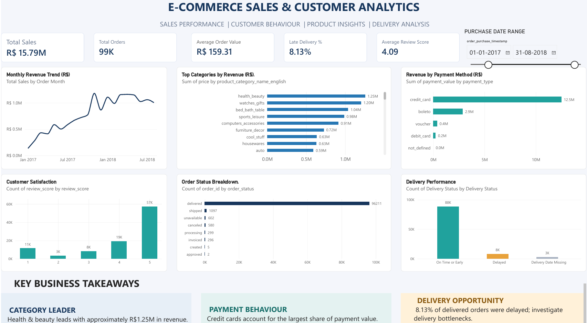

# E-Commerce Sales & Customer Analytics

An end-to-end data analytics project exploring sales performance, product categories, customer satisfaction, payment preferences, and delivery performance using **MySQL and Power BI**.

## Dashboard Preview



## Business Objectives

- Track monthly sales trends and overall order performance.
- Identify top-performing product categories by revenue.
- Understand customer payment preferences.
- Evaluate customer satisfaction using review scores.
- Analyse delivery performance and identify potential bottlenecks.

## Tools & Technologies

- **MySQL:** Data querying, aggregation, joins, and business analysis.
- **Power BI Desktop:** Interactive dashboard development and visualisation.
- **SQL:** Revenue analysis, category comparisons, payment analysis, and delivery performance.

## Key Performance Indicators

| KPI | Dashboard Result |
|---|---:|
| Total Sales | R$ 15.79M |
| Total Orders | Approximately 99K |
| Average Order Value | R$ 159.31 |
| Late Delivery Rate | 8.13% |
| Average Review Score | 4.09 / 5 |

*These are the figures currently displayed on the dashboard; results depend on the selected date range and underlying calculations.*

## Key Business Insights

- **Category performance:** Health and beauty leads the displayed product-category revenue ranking.
- **Payment behaviour:** Credit cards account for the largest share of payment value.
- **Customer satisfaction:** Five-star reviews are the most frequent rating.
- **Delivery performance:** Approximately 8.13% of delivered orders are classified as delayed on the dashboard, highlighting an area for further investigation.

## Repository Structure

```text
ecommerce-sales-customer-analytics/
├── screenshots/
│   └── dashboard.png
├── sql/
│   └── ecommerce_analysis.sql
└── README.md
```

## Dataset

This project uses the Brazilian E-Commerce Public Dataset by Olist, available on Kaggle.

Dataset source: https://www.kaggle.com/datasets/olistbr/brazilian-ecommerce

## How to Explore the Project

1. Open `sql/ecommerce_analysis.sql` to review the SQL queries.
2. View `screenshots/dashboard.png` to explore the dashboard preview.
3. Use the dashboard KPIs and visualisations to understand the business questions explored.

## Author

**Anish Mayya**
